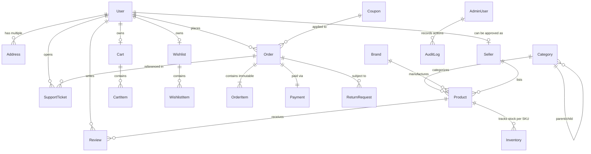

# Aventra Marketplace — Database Schema Specification

## 1. Overview & Data Design Philosophy

The database engine is **PostgreSQL** with **Prisma ORM**. 

E-commerce systems demand a thoughtful balance between normalized relational integrity and immutable financial snapshots:
- **Relational Integrity via Foreign Keys:** Users, Products, Categories, Sellers, Addresses, and Inventory are linked via strictly-enforced foreign keys with cascading rules to guarantee referential consistency.
- **Immutable Snapshots for Financial History:** When an order is placed, line items (`title`, `sku`, `unitPrice`, `tax`, `discount`, `sellerId`, `selectedVariant`) and address snapshots are stored immutably (`order_items` table and JSON snapshots). If a seller modifies product details in the future, past completed orders remain legally and historically exact.
- **ACID Transactions:** Checkout stock deductions, order creation, and payment verification leverage PostgreSQL native ACID multi-row transactions with row-level locking.

---

## 2. Entity-Relationship Diagram (ERD)



---

## 3. Detailed Collection Specifications

### 3.1 `users` Collection
Stores authentication, authorization, and customer identity data.

| Field | Type | Required | Unique | Default | Description / Notes |
| :--- | :--- | :--- | :--- | :--- | :--- |
| `_id` | ObjectId | Yes | Yes | auto | Primary identifier |
| `name` | String | Yes | No | - | Full customer/user name |
| `email` | String | Yes | Yes | - | Lowercased, indexed for login |
| `phone` | String | No | No | null | Contact phone number |
| `passwordHash` | String | Yes | No | - | Argon2id or bcrypt hash |
| `role` | String | Yes | No | `customer` | Enum: `customer`, `seller`, `admin` |
| `status` | String | Yes | No | `active` | Enum: `active`, `suspended`, `banned` |
| `tokenVersion` | Number | Yes | No | `0` | Incremented to invalidate all active JWTs |
| `emailVerified` | Boolean | Yes | No | `false` | Email confirmation flag |
| `avatar` | String | No | No | null | Profile image URL |
| `defaultAddressId`| ObjectId | No | No | null | Ref: `addresses` |
| `createdAt` | Date | Yes | No | auto | Timestamp |
| `updatedAt` | Date | Yes | No | auto | Timestamp |

**Indexes:**
- `{ email: 1 }` (unique)
- `{ role: 1 }`
- `{ status: 1 }`

---

### 3.2 `addresses` Collection
Stores user shipping and billing addresses.

| Field | Type | Required | Default | Description / Notes |
| :--- | :--- | :--- | :--- | :--- |
| `_id` | ObjectId | Yes | auto | Primary identifier |
| `userId` | ObjectId | Yes | - | Ref: `users` (Indexed) |
| `fullName` | String | Yes | - | Recipient's full name |
| `phone` | String | Yes | - | Recipient contact number |
| `addressLine1` | String | Yes | - | Street address, flat/house number |
| `addressLine2` | String | No | null | Apartment, suite, unit, building |
| `landmark` | String | No | null | Nearby landmark for delivery |
| `city` | String | Yes | - | City / District |
| `state` | String | Yes | - | State / Province |
| `postalCode` | String | Yes | - | PIN / ZIP Code |
| `country` | String | Yes | `IN` | ISO 3166-1 alpha-2 country code |
| `addressType` | String | Yes | `home` | Enum: `home`, `office`, `other` |
| `isDefaultShipping` | Boolean | Yes | `false` | Default shipping target |
| `isDefaultBilling` | Boolean | Yes | `false` | Default billing target |

**Indexes:**
- `{ userId: 1, isDefaultShipping: -1 }`

---

### 3.3 `categories` Collection
Hierarchical taxonomy for organizing the catalogue.

| Field | Type | Required | Unique | Default | Description |
| :--- | :--- | :--- | :--- | :--- | :--- |
| `_id` | ObjectId | Yes | Yes | auto | Primary identifier |
| `name` | String | Yes | No | - | Category display name |
| `slug` | String | Yes | Yes | - | URL-friendly slug (e.g. `smartphones`) |
| `description` | String | No | No | null | Category summary |
| `parentId` | ObjectId | No | No | null | Ref: `categories` (null for root) |
| `image` | String | No | No | null | Category promotional image URL |
| `icon` | String | No | No | null | Lucide icon identifier |
| `displayOrder` | Number | Yes | No | `0` | Sort order in mega navigation |
| `isActive` | Boolean | Yes | No | `true` | Visibility toggle |

**Indexes:**
- `{ slug: 1 }` (unique)
- `{ parentId: 1, displayOrder: 1 }`

---

### 3.4 `brands` Collection
Catalogued product brands.

| Field | Type | Required | Unique | Default | Description |
| :--- | :--- | :--- | :--- | :--- | :--- |
| `_id` | ObjectId | Yes | Yes | auto | Primary identifier |
| `name` | String | Yes | No | - | Brand name (e.g., Apple, Sony) |
| `slug` | String | Yes | Yes | - | URL slug |
| `logo` | String | No | No | null | Brand logo URL |
| `description`| String | No | No | null | Brand bio |

**Indexes:**
- `{ slug: 1 }` (unique)

---

### 3.5 `products` Collection
Master product definition with attributes, media, and variant definitions.

| Field | Type | Required | Description |
| :--- | :--- | :--- | :--- |
| `_id` | ObjectId | Yes | Primary identifier |
| `title` | String | Yes | Product name / title |
| `slug` | String | Yes | Unique URL slug |
| `description` | String | Yes | Full markdown description |
| `shortDescription`| String | No | Concise summary for search cards |
| `categoryId` | ObjectId | Yes | Ref: `categories` |
| `brandId` | ObjectId | No | Ref: `brands` |
| `sellerId` | ObjectId | Yes | Ref: `sellers` |
| `basePrice` | Number | Yes | Selling price in integer minor units (e.g. cents/paise) |
| `mrp` | Number | Yes | Maximum Retail Price / List Price |
| `sku` | String | Yes | Master SKU identifier |
| `images` | Array[String]| Yes | Array of image URLs (min 1 required) |
| `thumbnail` | String | Yes | Primary thumbnail URL |
| `attributes` | Object | No | Key-value specs (e.g. `{ "RAM": "16GB", "OS": "Android" }`) |
| `hasVariants` | Boolean | Yes | Flag indicating if product has variant options |
| `variants` | Array[Object]| No | Array of variant specifications (see below) |
| `isPublished` | Boolean | Yes | Publication status (default: `true`) |
| `isFeatured` | Boolean | Yes | Hero / Deal showcase flag |
| `averageRating` | Number | Yes | Cached rating average (0.0 to 5.0) |
| `reviewCount` | Number | Yes | Total approved reviews count |
| `isDeleted` | Boolean | Yes | Soft-deletion flag (default: `false`) |
| `tags` | Array[String]| No | Search keywords and categorization tags |

#### Subdocument: `ProductVariant`
```json
{
  "variantSku": "IPH15-BLK-128",
  "title": "Black / 128 GB",
  "attributes": {
    "color": "Midnight Black",
    "storage": "128GB"
  },
  "price": 7990000,
  "mrp": 8490000,
  "images": ["url1", "url2"],
  "stock": 25
}
```

**Indexes:**
- `{ slug: 1 }` (unique)
- `{ categoryId: 1, isPublished: 1, isDeleted: 1 }`
- `{ sellerId: 1 }`
- `{ basePrice: 1 }`
- `{ averageRating: -1 }`
- `{ title: "text", description: "text", tags: "text" }` (Full-text index)

---

### 3.6 `inventory` Collection
Precise stock tracking per SKU with atomic reservation capabilities.

| Field | Type | Required | Default | Description |
| :--- | :--- | :--- | :--- | :--- |
| `_id` | ObjectId | Yes | auto | Primary identifier |
| `productId` | ObjectId | Yes | - | Ref: `products` |
| `sku` | String | Yes | - | Unique SKU across product variants |
| `sellerId` | ObjectId | Yes | - | Ref: `sellers` |
| `availableQuantity` | Number | Yes | `0` | Available stock ready for purchase |
| `reservedQuantity` | Number | Yes | `0` | Locked stock under active checkouts |
| `lowStockThreshold` | Number | Yes | `5` | Alert trigger for restock warnings |
| `reservations` | Array[Object]| No | `[]` | Active checkout reservations (with TTL) |

#### Subdocument: `ReservationItem`
```json
{
  "reservationId": "res_abc123",
  "userId": "user_id_456",
  "quantity": 2,
  "expiresAt": "2026-10-22T13:15:00.000Z"
}
```

**Indexes:**
- `{ sku: 1 }` (unique)
- `{ productId: 1 }`
- `{ "reservations.expiresAt": 1 }` (TTL cleanup index)

---

### 3.7 `carts` Collection
User and guest shopping cart contents with real-time price synchronization.

| Field | Type | Required | Default | Description |
| :--- | :--- | :--- | :--- | :--- |
| `_id` | ObjectId | Yes | auto | Primary identifier |
| `userId` | ObjectId | No | null | Ref: `users` (null for guest cart) |
| `guestSessionId` | String | No | null | Anonymous session identifier |
| `items` | Array[Object]| Yes | `[]` | Cart item entries |
| `updatedAt` | Date | Yes | auto | Last modification timestamp |

#### Subdocument: `CartItem`
```json
{
  "productId": "ObjectId(products)",
  "sku": "IPH15-BLK-128",
  "quantity": 1,
  "priceAtAdd": 7990000,
  "selectedVariant": {
    "color": "Midnight Black",
    "storage": "128GB"
  }
}
```

**Indexes:**
- `{ userId: 1 }` (sparse, unique)
- `{ guestSessionId: 1 }` (sparse)

---

### 3.8 `wishlists` Collection
Customer-saved products for later acquisition.

| Field | Type | Required | Description |
| :--- | :--- | :--- | :--- |
| `_id` | ObjectId | Yes | Primary identifier |
| `userId` | ObjectId | Yes | Ref: `users` (Unique per user) |
| `items` | Array[Object]| Yes | `[{ productId: ObjectId, addedAt: Date }]` |

**Indexes:**
- `{ userId: 1 }` (unique)

---

### 3.9 `coupons` Collection
Platform and promotional discount vouchers.

| Field | Type | Required | Default | Description |
| :--- | :--- | :--- | :--- | :--- |
| `_id` | ObjectId | Yes | auto | Primary identifier |
| `code` | String | Yes | - | Upper-case code (e.g. `WELCOME10`) |
| `discountType` | String | Yes | `percentage` | Enum: `percentage`, `fixed_amount` |
| `discountValue` | Number | Yes | - | Percentage (e.g. 15 for 15%) or Minor Units (e.g. 50000) |
| `minOrderValue` | Number | Yes | `0` | Minimum subtotal required |
| `maxDiscountAmount`| Number | No | null | Cap on percentage discount |
| `startDate` | Date | Yes | - | Activation date |
| `expiryDate` | Date | Yes | - | Expiration date |
| `usageLimit` | Number | Yes | `1000` | Max global redemptions |
| `usedCount` | Number | Yes | `0` | Current redemption tally |
| `userUsageLimit` | Number | Yes | `1` | Max redemptions per individual user |
| `isActive` | Boolean | Yes | `true` | Emergency administrative disable |

**Indexes:**
- `{ code: 1 }` (unique)
- `{ isActive: 1, startDate: 1, expiryDate: 1 }`

---

### 3.10 `orders` Collection
Authoritative purchase records with immutable item snapshots.

| Field | Type | Required | Description |
| :--- | :--- | :--- | :--- |
| `_id` | ObjectId | Yes | Primary identifier |
| `orderNumber` | String | Yes | Human-readable order ID (e.g., `ORD-20261022-83921`) |
| `userId` | ObjectId | Yes | Ref: `users` |
| `items` | Array[Object]| Yes | Immutable item snapshots (see below) |
| `shippingAddress` | Object | Yes | Immutable copy of delivery address at purchase |
| `billingAddress` | Object | Yes | Immutable copy of billing address at purchase |
| `orderStatus` | String | Yes | Enum: `placed`, `processing`, `shipped`, `delivered`, `cancelled`, `returned` |
| `paymentStatus` | String | Yes | Enum: `pending`, `succeeded`, `failed`, `refunded` |
| `paymentMethod` | String | Yes | Enum: `card`, `upi`, `netbanking`, `cod`, `sandbox` |
| `paymentId` | ObjectId | No | Ref: `payments` |
| `subtotal` | Number | Yes | Sum of line items in minor units |
| `discountAmount` | Number | Yes | Coupon or promotional savings applied |
| `shippingFee` | Number | Yes | Calculated shipping charges |
| `taxAmount` | Number | Yes | Tax / GST calculated on subtotal |
| `grandTotal` | Number | Yes | Final payable amount (subtotal - discount + shipping + tax) |
| `couponCode` | String | No | Applied coupon code if any |
| `trackingTimeline` | Array[Object]| Yes | Chronological milestone records (status, timestamp, note) |
| `carrier` | String | No | Logistics provider name |
| `trackingNumber` | String | No | Shipment tracking code |
| `estimatedDelivery`| Date | Yes | Estimated date of arrival |
| `cancellationReason`| String| No | Customer or admin reason if cancelled |

#### Subdocument: `OrderItemSnapshot`
```json
{
  "productId": "ObjectId(products)",
  "sku": "IPH15-BLK-128",
  "title": "Smartphone Aventra Pro 15",
  "selectedVariant": "Black / 128 GB",
  "thumbnail": "https://img.cdn/iphone.jpg",
  "sellerId": "ObjectId(sellers)",
  "quantity": 1,
  "unitPrice": 7990000,
  "unitDiscount": 0,
  "taxRate": 18,
  "lineTotal": 7990000,
  "status": "placed",
  "isReviewed": false
}
```

**Indexes:**
- `{ orderNumber: 1 }` (unique)
- `{ userId: 1, createdAt: -1 }`
- `{ orderStatus: 1 }`
- `{ "items.sellerId": 1 }`

---

### 3.11 `payments` Collection
Transaction ledger recording payment attempts, gateway tokens, and webhooks.

| Field | Type | Required | Description |
| :--- | :--- | :--- | :--- |
| `_id` | ObjectId | Yes | Primary identifier |
| `orderId` | ObjectId | Yes | Ref: `orders` |
| `userId` | ObjectId | Yes | Ref: `users` |
| `provider` | String | Yes | Enum: `stripe`, `razorpay`, `mock_sandbox` |
| `transactionId` | String | Yes | Gateway transaction / charge ID |
| `idempotencyKey`| String | Yes | UUID to prevent duplicate charges |
| `amount` | Number | Yes | Total transaction amount in minor units |
| `currency` | String | Yes | ISO currency code (e.g. `INR`, `USD`) |
| `status` | String | Yes | Enum: `initiated`, `pending`, `succeeded`, `failed`, `refunded` |
| `gatewayResponse`| Object | No | Raw sanitized payload received from gateway |
| `webhookEvents` | Array[Object]| No | Audit log of received gateway webhooks |

**Indexes:**
- `{ transactionId: 1 }` (unique)
- `{ idempotencyKey: 1 }` (unique)
- `{ orderId: 1 }`

---

### 3.12 `reviews` Collection
Verified product reviews and ratings.

| Field | Type | Required | Description |
| :--- | :--- | :--- | :--- |
| `_id` | ObjectId | Yes | Primary identifier |
| `productId` | ObjectId | Yes | Ref: `products` |
| `userId` | ObjectId | Yes | Ref: `users` |
| `orderId` | ObjectId | Yes | Ref: `orders` (Proves purchase) |
| `rating` | Number | Yes | Integer rating between 1 and 5 |
| `title` | String | Yes | Short review summary |
| `comment` | String | Yes | Detailed written feedback |
| `images` | Array[String]| No | Customer uploaded photos |
| `isVerifiedPurchase`| Boolean | Yes | True if backed by completed order |
| `helpfulVotes` | Number | Yes | Count of helpful votes |
| `helpfulVoters`| Array[ObjectId]| No | Users who upvoted (prevents duplicate votes) |
| `status` | String | Yes | Enum: `published`, `flagged`, `removed` |

**Indexes:**
- `{ productId: 1, userId: 1, orderId: 1 }` (unique: 1 review per purchase)
- `{ productId: 1, status: 1, createdAt: -1 }`

---

### 3.13 `return_requests` Collection
Customer-initiated return and replacement workflows.

| Field | Type | Required | Description |
| :--- | :--- | :--- | :--- |
| `_id` | ObjectId | Yes | Primary identifier |
| `orderId` | ObjectId | Yes | Ref: `orders` |
| `userId` | ObjectId | Yes | Ref: `users` |
| `sellerId` | ObjectId | Yes | Ref: `sellers` |
| `sku` | String | Yes | Specific SKU returned |
| `quantity` | Number | Yes | Number of units returned |
| `reason` | String | Yes | Enum: `damaged`, `defective`, `wrong_item`, `unwanted` |
| `customerNotes`| String | No | Additional explanation |
| `evidenceImages`| Array[String]| No | Uploaded inspection images |
| `status` | String | Yes | Enum: `requested`, `approved`, `pickup_scheduled`, `received`, `inspected`, `refunded`, `rejected` |
| `refundAmount` | Number | Yes | Minor units to be credited |
| `adminNotes` | String | No | Internal decision record |

**Indexes:**
- `{ orderId: 1 }`
- `{ userId: 1 }`
- `{ status: 1 }`

---

### 3.14 `support_tickets` Collection
Customer care ticketing system with message history.

| Field | Type | Required | Description |
| :--- | :--- | :--- | :--- |
| `_id` | ObjectId | Yes | Primary identifier |
| `ticketNumber`| String | Yes | Unique reference (e.g. `TCK-2026-9041`) |
| `userId` | ObjectId | Yes | Ref: `users` |
| `orderId` | ObjectId | No | Optional Ref: `orders` |
| `subject` | String | Yes | Issue subject |
| `category` | String | Yes | Enum: `order`, `payment`, `delivery`, `return`, `account`, `other` |
| `priority` | String | Yes | Enum: `low`, `medium`, `high`, `urgent` |
| `status` | String | Yes | Enum: `open`, `in_progress`, `waiting_customer`, `resolved`, `closed` |
| `messages` | Array[Object]| Yes | Threaded dialog between user and agent |

---

### 3.15 `sellers` Collection
Vendor registration and business profile.

| Field | Type | Required | Description |
| :--- | :--- | :--- | :--- |
| `_id` | ObjectId | Yes | Primary identifier |
| `userId` | ObjectId | Yes | Ref: `users` (Owner account) |
| `businessName`| String | Yes | Legal store name |
| `slug` | String | Yes | Unique URL store slug |
| `registrationNo`| String | Yes | Company registration / GSTIN |
| `taxId` | String | Yes | Tax identification number |
| `bankAccount`| Object | Yes | Payout details (masked) |
| `address` | Object | Yes | Registered business address |
| `status` | String | Yes | Enum: `pending_approval`, `approved`, `suspended`, `rejected` |
| `commissionRate`| Number | Yes | Percentage platform fee (e.g. 10%) |
| `rating` | Number | Yes | Vendor average review rating |

---

### 3.16 `notifications` Collection
In-app customer alerts for transactional milestones.

| Field | Type | Required | Description |
| :--- | :--- | :--- | :--- |
| `_id` | ObjectId | Yes | Primary identifier |
| `userId` | ObjectId | Yes | Ref: `users` |
| `type` | String | Yes | Enum: `order_status`, `payment`, `price_drop`, `promo`, `system` |
| `title` | String | Yes | Notification heading |
| `message` | String | Yes | Body text |
| `link` | String | No | Target URL (e.g. `/orders/ORD-123`) |
| `isRead` | Boolean | Yes | Read flag (default: `false`) |
| `createdAt` | Date | Yes | Auto timestamp |

---

### 3.17 `audit_logs` Collection
Immutable record of sensitive administrative and seller interventions.

| Field | Type | Required | Description |
| :--- | :--- | :--- | :--- |
| `_id` | ObjectId | Yes | Primary identifier |
| `actorUserId`| ObjectId | Yes | Ref: `users` (Who took the action) |
| `actorRole` | String | Yes | Role at time of action (`admin` or `seller`) |
| `action` | String | Yes | Event name (e.g. `PRODUCT_APPROVED`, `REFUND_ISSUED`) |
| `targetEntity`| String | Yes | Collection affected (e.g. `orders`, `products`) |
| `targetId` | ObjectId | Yes | ID of affected document |
| `changes` | Object | No | `{ before: ..., after: ... }` diff payload |
| `ipAddress` | String | No | Client IP address |
| `userAgent` | String | No | Client browser user agent |
| `timestamp` | Date | Yes | Exact time of intervention |

**Indexes:**
- `{ actorUserId: 1, timestamp: -1 }`
- `{ targetEntity: 1, targetId: 1 }`
