# Aventra Marketplace — Implementation Roadmap & Execution Plan

## 1. Roadmap Overview & Phased Strategy

The Aventra platform is built in **17 sequential, dependency-aware modules** across four primary phases. Each module represents an independently testable, fully integrated slice connecting the UI, API, and persistent database.

```mermaid
gantt
    title Aventra Phased Implementation Roadmap
    dateFormat  X
    axisFormat  Day %d

    section Phase 1: Core Shopping
    Module 00 (Audit & Architecture)     :active, m00, 0, 1
    Module 01 (Foundation & Setup)       :m01, after m00, 1
    Module 02 (Storefront UI & Nav)      :m02, after m01, 2
    Module 03 (Auth & Accounts)          :m03, after m02, 2
    Module 04 (Catalogue & Detail Pages) :m04, after m03, 2
    Module 05 (Search & Discovery)       :m05, after m04, 2
    Module 06 (Cart & Wishlist)          :m06, after m05, 2

    section Phase 2: Transactions
    Module 07 (Checkout & Addresses)     :m07, after m06, 2
    Module 08 (Payment Sandbox)          :m08, after m07, 2
    Module 09 (Orders & Tracking)        :m09, after m08, 2

    section Phase 3: Marketplace
    Module 10 (Admin Dashboard)          :m10, after m09, 2
    Module 11 (Seller Portal)            :m11, after m10, 2
    Module 12 (Reviews & Ratings)        :m12, after m11, 2
    Module 13 (Returns & Support)        :m13, after m12, 2
    Module 14 (Coupons & Alerts)         :m14, after m13, 2

    section Phase 4: Quality & Release
    Module 15 (Security & E2E Testing)   :m15, after m14, 2
    Module 16 (Production Readiness)     :m16, after m15, 1
```

---

## 2. Module-by-Module Detailed Breakdown

### Phase 1: Core Shopping Experience (Modules 00–06)

#### Module 00 — Repository Audit & Master Architecture (CURRENT)
- **Dependencies:** None.
- **Objectives:** Inspect existing repository, verify runtime environment, formulate architectural specs, database models, REST contracts, and phase roadmap.
- **Deliverables:** `docs/PROJECT_REQUIREMENTS.md`, `docs/SYSTEM_ARCHITECTURE.md`, `docs/DATABASE_SCHEMA.md`, `docs/API_SPECIFICATION.md`, `docs/IMPLEMENTATION_ROADMAP.md`, `docs/PROGRESS.md`.
- **Acceptance Criteria:** Comprehensive design documents created, zero conflicting or broken files, ready for Module 01 execution.

#### Module 01 — Full-Stack Project Foundation
- **Dependencies:** Module 00.
- **Objectives:** Scaffold `frontend/` (React, Vite, TS, Tailwind) and `backend/` (Node.js, Express, TS, Mongoose) with clean separation.
- **Key Files:** `backend/src/app.ts`, `backend/src/server.ts`, `backend/src/config/db.ts`, `frontend/src/App.tsx`, `frontend/src/main.tsx`, `.env.example`.
- **Acceptance Criteria:**
  - `GET /api/v1/health` and `GET /api/v1/ready` return 200 OK.
  - MongoDB connection initializes and reconnects cleanly.
  - Frontend launches on `http://localhost:5173` without console warnings.
  - TypeScript checks pass on both client and server.

#### Module 02 — Complete Responsive Retail Storefront UI
- **Dependencies:** Module 01.
- **Objectives:** Build original Amazon-inspired visual storefront: top navigation with search bar, mega-nav, hero deals carousel, category showcases, responsive product cards, and footer.
- **Key Files:** `Header.tsx`, `MegaNav.tsx`, `HeroCarousel.tsx`, `ProductCard.tsx`, `HomePage.tsx`, `Footer.tsx`.
- **Acceptance Criteria:**
  - Fully responsive on desktop (1440px), tablet (768px), and mobile (375px).
  - Search bar, cart icon, account dropdown render cleanly.
  - Empty states and skeleton loading cards render smoothly.

#### Module 03 — Authentication & Customer Accounts
- **Dependencies:** Module 02.
- **Objectives:** End-to-end customer registration, login, logout, password hashing with Argon2id/bcrypt, JWT access & refresh tokens with HTTP-only cookies, address book CRUD.
- **Key Files:** `User.model.ts`, `Address.model.ts`, `auth.service.ts`, `auth.controller.ts`, `auth.middleware.ts`, `LoginPage.tsx`, `RegisterPage.tsx`, `AccountProfile.tsx`.
- **Acceptance Criteria:**
  - Users can register, log in, view their account profile, and securely log out.
  - Passwords hashed safely.
  - RBAC prevents role tampering; users cannot elevate themselves to admin or seller.

#### Module 04 — Product Catalogue & Product Details
- **Dependencies:** Module 03.
- **Objectives:** Hierarchical categories, brands, products with multi-variant modeling (size/color/storage), SKU inventory integration, detailed PDP (image gallery, variant selector, specs).
- **Key Files:** `Product.model.ts`, `Category.model.ts`, `product.service.ts`, `ProductDetailPage.tsx`, `VariantSelector.tsx`, `seedData.ts`.
- **Acceptance Criteria:**
  - Seeded realistic products load from MongoDB.
  - Product detail page switches images and prices based on selected variant.
  - Out-of-stock items disable purchase buttons with clear messaging.

#### Module 05 — Search, Filters, Sorting & Pagination
- **Dependencies:** Module 04.
- **Objectives:** Full-text MongoDB search, live debounced autocomplete in header, faceted filters (category, brand, price slider, rating, in-stock), sorting, and URL sync.
- **Key Files:** `search.service.ts`, `search.controller.ts`, `SearchResultsPage.tsx`, `FilterSidebar.tsx`, `SortDropdown.tsx`.
- **Acceptance Criteria:**
  - Typing in search bar offers instant relevant suggestions.
  - Filter combinations (e.g. Category + Price + Rating) return accurate paginated counts.
  - Search state survives page refreshes via URL parameters.

#### Module 06 — Persistent Cart & Wishlist
- **Dependencies:** Module 05.
- **Objectives:** Database-backed cart for authenticated users, local storage guest cart with merge upon login, real-time stock checks, quantity update limits, and wishlist management.
- **Key Files:** `Cart.model.ts`, `Wishlist.model.ts`, `cart.service.ts`, `CartPage.tsx`, `WishlistPage.tsx`, `cartStore.ts`.
- **Acceptance Criteria:**
  - Guest cart seamlessly merges into customer cart on login.
  - Real-time stock validation prevents adding more than current stock.
  - Subtotal, estimated tax, and shipping compute dynamically on the backend.

---

### Phase 2: Transactions & Order Fulfillment (Modules 07–09)

#### Module 07 — Checkout & Order Preparation
- **Dependencies:** Module 06.
- **Objectives:** Multi-step checkout flow (address selection, delivery method, coupon application, order review) with 15-minute temporary inventory reservation.
- **Key Files:** `checkout.service.ts`, `CheckoutPage.tsx`, `Coupon.model.ts`, `coupon.service.ts`, `OrderSummary.tsx`.
- **Acceptance Criteria:**
  - Stock is atomically reserved with TTL when proceeding to payment.
  - Coupons validate minimum spend, expiry, and single-use constraints.
  - Abandoned checkouts release stock back to general inventory.

#### Module 08 — Secure Payment Gateway Integration
- **Dependencies:** Module 07.
- **Objectives:** Provider-agnostic payment sandbox integration (Stripe / Razorpay sandbox + dev simulator), cryptographic webhook handling, idempotency checks.
- **Key Files:** `payment.service.ts`, `payment.controller.ts`, `Payment.model.ts`, `PaymentModal.tsx`, `webhook.handler.ts`.
- **Acceptance Criteria:**
  - Server verifies webhook signature before updating payment status.
  - Duplicate webhook events do not generate duplicate orders or charges.
  - Clear success, failure, and retry UI states.

#### Module 09 — Order Management & Tracking
- **Dependencies:** Module 08.
- **Objectives:** Immutable order snapshotting, customer order history, status timeline (Placed -> Processing -> Shipped -> Delivered), self-service cancellation, downloadable invoices.
- **Key Files:** `Order.model.ts`, `order.service.ts`, `OrderHistoryPage.tsx`, `OrderDetailPage.tsx`, `TrackingTimeline.tsx`, `invoiceGenerator.ts`.
- **Acceptance Criteria:**
  - Historical order details do not alter when catalog products are modified.
  - Customers can track order milestone progression.
  - Eligible orders can be cancelled with immediate inventory restoration.

---

### Phase 3: Marketplace & Operations (Modules 10–14)

#### Module 10 — Administrator Dashboard & Operations
- **Dependencies:** Module 09.
- **Objectives:** Dedicated admin portal: sales analytics (GMV, orders), catalogue moderation, inventory adjustments, order overrides, user account suspension, audit logging.
- **Key Files:** `AdminLayout.tsx`, `AdminDashboard.tsx`, `AdminProducts.tsx`, `AdminOrders.tsx`, `AuditLog.model.ts`.
- **Acceptance Criteria:**
  - Strict backend RBAC blocks unauthorized users.
  - Admins can view platform revenue charts, manage stock, and audit user activity.

#### Module 11 — Multi-Vendor Seller Marketplace
- **Dependencies:** Module 10.
- **Objectives:** Vendor onboarding flow, isolated seller portal, product listing submissions, stock adjustments, order item shipping updates, commission tracking.
- **Key Files:** `Seller.model.ts`, `seller.service.ts`, `SellerPortal.tsx`, `SellerListings.tsx`, `SellerOrders.tsx`.
- **Acceptance Criteria:**
  - Vendors only see and manage their own listings and order items.
  - Orders containing items from multiple sellers are fulfilled independently per vendor.

#### Module 12 — Ratings, Reviews & Recommendations
- **Dependencies:** Module 11.
- **Objectives:** Verified purchase reviews (1 to 5 stars, text, photos), helpful vote deduplication, server-side rating aggregation, "Frequently Bought Together" recommendations.
- **Key Files:** `Review.model.ts`, `review.service.ts`, `ReviewsList.tsx`, `WriteReviewModal.tsx`, `recommendation.service.ts`.
- **Acceptance Criteria:**
  - Only confirmed purchasers can write reviews (with Verified Purchase badge).
  - Product average rating updates atomically on new reviews.

#### Module 13 — Returns, Refunds & Customer Support
- **Dependencies:** Module 12.
- **Objectives:** Customer-initiated returns within return window, admin/seller inspection workflow, refund dispatch, customer care support ticket threading.
- **Key Files:** `ReturnRequest.model.ts`, `SupportTicket.model.ts`, `ReturnsPage.tsx`, `SupportTicketPage.tsx`.
- **Acceptance Criteria:**
  - Return requests validate eligibility window and item condition.
  - Threaded ticket communication between customers and support staff.

#### Module 14 — Promotions, Notifications & Price Alerts
- **Dependencies:** Module 13.
- **Objectives:** Admin coupon management, transactional email notification templates, in-app notification center, price drop watchlists.
- **Key Files:** `Notification.model.ts`, `email.service.ts`, `NotificationCenter.tsx`, `AdminCoupons.tsx`.
- **Acceptance Criteria:**
  - System dispatches in-app and email alerts upon order status changes.
  - Price drop alerts trigger when product price falls below customer watch threshold.

---

### Phase 4: Quality & Release (Modules 15–16)

#### Module 15 — Security, Automated Testing & Quality Audit
- **Dependencies:** Module 14.
- **Objectives:** End-to-end security hardening (OWASP Top 10, rate limiting, NoSQL injection prevention, XSS sanitation), unit tests, integration tests, Playwright E2E browser tests.
- **Key Files:** `tests/auth.test.ts`, `tests/checkout.test.ts`, `tests/e2e/shopping.spec.ts`.
- **Acceptance Criteria:**
  - All test suites execute and pass on Windows environment.
  - Verified race-condition safety on simultaneous checkouts of limited stock.

#### Module 16 — Deployment & Production Readiness
- **Dependencies:** Module 15.
- **Objectives:** Production builds (`npm run build`), environment configuration runbooks, MongoDB Atlas setup guides, CI/CD configuration, final progress signoff.
- **Deliverables:** `docs/DEPLOYMENT.md`, `docs/SECURITY_CHECKLIST.md`, `docs/KNOWN_LIMITATIONS.md`, final `README.md`.
- **Acceptance Criteria:**
  - Production client and server bundles build without warnings.
  - Complete operational runbook ready for deployment.

---

## 3. Engineering Risk Matrix & Mitigations

| Risk | Impact | Mitigation Strategy |
| :--- | :--- | :--- |
| **Inventory Overselling** | High | Atomic MongoDB `$inc` operations with condition `{ availableQuantity: { $gte: requested } }` and TTL-backed reservation locks. |
| **Duplicate Payments** | High | Mandatory `idempotencyKey` UUIDs on checkout requests and cryptographic verification of gateway webhooks. |
| **Cross-Tenant Data Leaks**| Critical| Strict seller scoping: Every seller API query enforces `{ sellerId: req.user.sellerId }` at the service layer. |
| **Floating-Point Errors** | Medium | All currency values stored as integer minor units (paise/cents). No decimals stored in monetary fields. |
| **Windows Path Issues** | Low | Use forward-slash normalization and `cross-env` in all npm scripts. |
