# Aventra Marketplace — Project Requirements Document

## 1. Executive Summary & Brand Identity

**Project Name:** Aventra (Amazon-inspired Modern Multi-Vendor E-Commerce Marketplace)  
**System Type:** Full-Stack Modular Monolith E-Commerce Application  
**Target Environment:** Windows 10/11 Development, Node.js v24+, React 19 / Vite, MongoDB Atlas / Local MongoDB  

Aventra is an end-to-end full-stack retail and marketplace platform inspired by the public shopping, order fulfillment, and multi-vendor workflows of global retail marketplaces like Amazon.in. The platform prioritizes high operational integrity: every user interaction (browsing, searching, cart updates, checkout, simulated/sandbox payment, order tracking, returns, reviews, and admin/seller operations) is backed by persistent database transactions, server-side validation, and defensive business logic.

> **Design Independence Guarantee:** Aventra features an original visual identity, custom styling system, and clean-room architectural implementation. No proprietary assets, logos, or private backend architectures of Amazon or any third party are utilized.

---

## 2. User Roles & Access Hierarchy

The system defines three primary actors with strict role-based access control (RBAC):

```mermaid
graph TD
    User([Platform User]) --> Customer[Customer Role]
    User --> Seller[Seller / Vendor Role]
    User --> Admin[Platform Administrator Role]

    Customer --> C1[Browse & Search Catalogue]
    Customer --> C2[Manage Addresses & Profile]
    Customer --> C3[Manage Cart & Wishlist]
    Customer --> C4[Execute Checkout & Sandbox Payments]
    Customer --> C5[Track Orders & Download Invoices]
    Customer --> C6[Submit Returns & Support Tickets]
    Customer --> C7[Submit Reviews for Verified Purchases]

    Seller --> S1[Apply for Vendor Account]
    Seller --> S2[Manage Approved Product Listings & SKUs]
    Seller --> S3[Update Inventory & Stock Levels]
    Seller --> S4[Manage Order Items & Mark Shipments]
    Seller --> S5[View Seller Analytics & Settlement Summaries]

    Admin --> A1[Manage System Users & Ban/Suspend Accounts]
    Admin --> A2[Approve/Reject Seller Applications]
    Admin --> A3[Moderate Categories, Brands & Products]
    Admin --> A4[Manage Global Inventory & Overrides]
    Admin --> A5[Inspect & Override Orders & Payments]
    Admin --> A6[Process Return Requests & Refunds]
    Admin --> A7[Manage Coupons & Platform Promotions]
    Admin --> A8[Moderate Reviews & Support Tickets]
    Admin --> A9[Audit Logs & Platform Financial Analytics]
```

---

## 3. Functional Requirements by Module

### Module 00: Project Analysis & Master Architecture
- Comprehensive audit of requirements, environment capabilities, and directory structure.
- Formulation of system architecture, data models, API schemas, and development roadmaps.
- Documentation baseline established in `/docs`.

### Module 01: Project Setup & Database Connection
- Clean monorepo structure separating `frontend/` and `backend/` with shared types.
- Frontend setup: React + Vite + TypeScript + Tailwind CSS + Lucide Icons.
- Backend setup: Node.js + Express + TypeScript with strict environment validation (Zod).
- MongoDB connection with automatic reconnection, health check (`/api/v1/health`), and readiness check (`/api/v1/ready`).
- Centralized error-handling middleware, request logging, and secure HTTP headers.

### Module 02: Responsive Retail Storefront UI
- Amazon-style comprehensive information architecture:
  - Top navigation bar: Brand logo, delivery location selector, categorized search bar, locale/currency, account menu, orders link, cart indicator with badge.
  - Secondary navigation: Category drawer menu ("All"), Prime-style deals, New Releases, Electronics, Fashion, Customer Service.
  - Hero carousel with promotional banners.
  - Multi-card grid sections: Deals of the Day, Category Showcases, Recommended Products, Best Sellers.
  - Product card components: Image, Title, Price, MRP, Discount percentage, Star rating, Review count, Stock status, Quick Add to Cart button.
  - Responsive desktop, tablet, and mobile layouts.

### Module 03: Authentication & Customer Accounts
- Registration with name, email, password, and phone.
- Password hashing using Argon2id / bcrypt with strong salt rounds.
- JWT-based authentication using short-lived access tokens (memory/header) and secure, HTTP-only, SameSite refresh tokens in cookies.
- Brute-force protection via IP and account-level rate limiting.
- Account profile management and multi-address book CRUD (shipping/billing flags, default address).
- Role isolation: Users cannot escalate their own roles.

### Module 04: Product Catalogue, Categories & Details
- Multi-tier category tree (e.g., Electronics > Audio > Headphones).
- Product schema supporting title, slug, description, markdown specs, brand, category, seller, base price, MRP, images, and attributes.
- Variant modeling: Size, color, storage capacity, style variants mapped to distinct SKUs with independent stock.
- Server-side discount and savings computation.
- Comprehensive Product Detail Page (PDP): Image gallery with thumbnail preview and zoom, variant picker, real-time stock status, delivery time estimator, seller information box, specification tables.

### Module 05: Search, Filtering, Sorting & Pagination
- Full-text search across product title, description, brand, and category tags.
- Debounced search bar with live auto-complete suggestions.
- Recent search history saved in client storage with clear options.
- Faceted filtering: Category, Brand, Price Range (min-max slider), Customer Rating (4★ & up), In-Stock Only, and Variant Attributes.
- Sorting options: Featured/Relevance, Price: Low to High, Price: High to Low, Average Customer Review, Newest Arrivals.
- Server-side paginated queries with URL query parameter synchronization.

### Module 06: Shopping Cart & Wishlist
- Persistent cart for authenticated users stored in MongoDB.
- Anonymous guest cart support stored in local storage, merging intelligently upon user login.
- Real-time stock validation: Prevents adding more than available inventory or exceeding per-order purchase limits.
- Price validation: Live price sync prevents stale checkout prices.
- Wishlist: Add/remove saved items, move items from wishlist directly to cart.

### Module 07: Address Management & Multi-Step Checkout
- Multi-step checkout workflow:
  1. Address Selection / Creation.
  2. Delivery Method Selection (Standard, Express, Next-Day).
  3. Coupon Application & Discount Recalculation.
  4. Order Review with item price breakdown (Subtotal, Tax, Shipping, Discount, Total).
- Safe temporary inventory reservation with TTL (Time-to-Live, e.g., 15 minutes) to prevent overselling during checkout.
- Automatic release of reserved inventory if checkout is abandoned or expires.

### Module 08: Payment Gateway Integration
- Sandbox payment provider abstraction (support for Stripe / Razorpay sandbox and simulated dev payments).
- Server-side payment intent/order creation.
- Webhook listener with cryptographic signature verification and idempotency protection against duplicate processing.
- Strict separation between Payment Status (`pending`, `succeeded`, `failed`, `refunded`) and Order Fulfillment Status (`placed`, `processing`, `shipped`, `delivered`, `cancelled`).
- Zero storage of raw card numbers, CVV, or banking credentials.

### Module 09: Orders, Delivery Tracking & Invoices
- Immutable order snapshots: At purchase, store exact product title, SKU, variant, seller reference, unit price, and discount so future catalogue edits do not alter historical records.
- Order confirmation screen with estimated delivery timeline.
- Customer order history with status filters (Last 30 Days, 6 Months, Archive).
- Interactive order tracking timeline showing fulfillment milestones.
- Order cancellation workflow with automated inventory restoration for eligible states.
- Clean printable/downloadable HTML/PDF order invoices with GST/Tax breakdowns.

### Module 10: Administrator Dashboard & Operations
- Analytics overview: Total Gross Merchandise Volume (GMV), net revenue, order volume, active customer count, low-stock warnings.
- Catalogue management: Category CRUD, brand management, product approval and soft-deletion.
- Inventory adjustment logs and global stock replenishment.
- Order management: Search by order number, inspect payment status, update delivery state.
- Customer management: View user activity, deactivate/ban abusive accounts.
- Audit logging: Recording all administrative interventions with user IDs, timestamps, and IP addresses.

### Module 11: Multi-Vendor Seller Marketplace
- Seller application, business verification, and onboarding flow.
- Isolated seller portal: Sellers only see and edit their own products, inventory, and order items.
- Split-order handling: When a customer order contains items from multiple sellers, fulfillment is tracked per-item/per-seller.
- Commission calculation: Configurable platform fee deducted from seller gross earnings.

### Module 12: Ratings, Reviews & Recommendation Engine
- Reviews restricted to verified purchasers of the product.
- Star rating (1 to 5), title, review body, and verified purchase badge.
- Helpful vote toggles with deduplication.
- Server-side rating aggregation: Cached average rating and rating distribution (5-star %, 4-star %, etc.).
- Recommendation engine: Recently viewed items (client-session), similar category items, and "frequently bought together" algorithms.

### Module 13: Returns, Refunds & Customer Support
- Self-service return initiation within a configurable window (e.g., 10 or 30 days post-delivery).
- Return reasons selection (defective, wrong item, damaged packaging, changed mind).
- Admin/Seller return inspection and approval workflow.
- Automated refund trigger upon return acceptance.
- Customer support ticketing system: Ticket creation, threaded customer-support agent messages, priority states.

### Module 14: Promotions, Coupons & Notifications
- Flexible coupon engine: Percentage off, fixed amount off, minimum order spend, category restrictions, single-use per customer.
- Event-driven notification system: Order placed, payment confirmed, item shipped, out for delivery, refund issued.
- Notification dispatch abstraction: Configurable email provider (SendGrid/Nodemailer mock) and in-app notification center.

### Module 15: Security, Automated Testing & Quality Audit
- Security verification: Helmet headers, strict CORS, rate limiters, input sanitization against NoSQL injection, XSS filtering.
- Automated testing suite: Unit tests (Vitest), API integration tests (Supertest), and End-to-End browser tests (Playwright).
- Edge-case testing: Race conditions in inventory checkout, double-click payment prevention, coupon expiration boundaries.

### Module 16: Deployment & Final Production Readiness
- Production build validation for frontend (Vite output) and backend (compiled TypeScript).
- Environment variable specification and security checklist.
- Database index verification and performance audit.
- Complete documentation: Setup guides, deployment runbooks, and known limitations.

---

## 4. Non-Functional Requirements

| Metric | Target | Rationale |
| :--- | :--- | :--- |
| **Response Latency** | API p95 < 120ms (read), < 250ms (write) | Ensures smooth, responsive retail UX |
| **Security Standard** | OWASP Top 10 compliance, Argon2id/bcrypt, zero credential logging | Protects user PII and transaction records |
| **Data Integrity** | ACID transactions for checkout, inventory, and order creation | Prevents overselling and phantom orders |
| **Availability** | Graceful degradation, offline guest cart, clear error states | Resilient to transient database or network interruptions |
| **Accessibility** | WCAG 2.1 AA standards, keyboard navigability, semantic tags | Accessible to all shoppers across desktop and mobile devices |
| **Compatibility** | Windows 10/11, macOS, Linux, Chrome, Firefox, Safari, Edge | Cross-platform development and deployment parity |

---

## 5. Development Constraints & Guardrails

1. **No Proprietary Code:** Implement original components and clean business logic.
2. **Zero Fake Operations:** Never pretend an API call succeeded or hardcode mock transactions on the live server.
3. **Server-Side Authority:** Never trust the client for prices, discounts, stock, role permissions, or payment status.
4. **Idempotency:** Payment webhooks and order placements must be idempotent to protect against network duplicates.
5. **Progressive Verification:** Each module must build, pass linting/type checks, and run successfully before the next module begins.    

