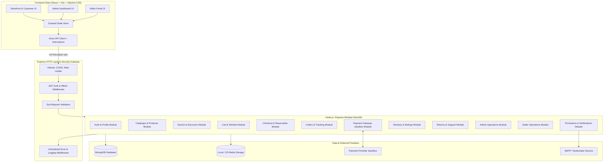
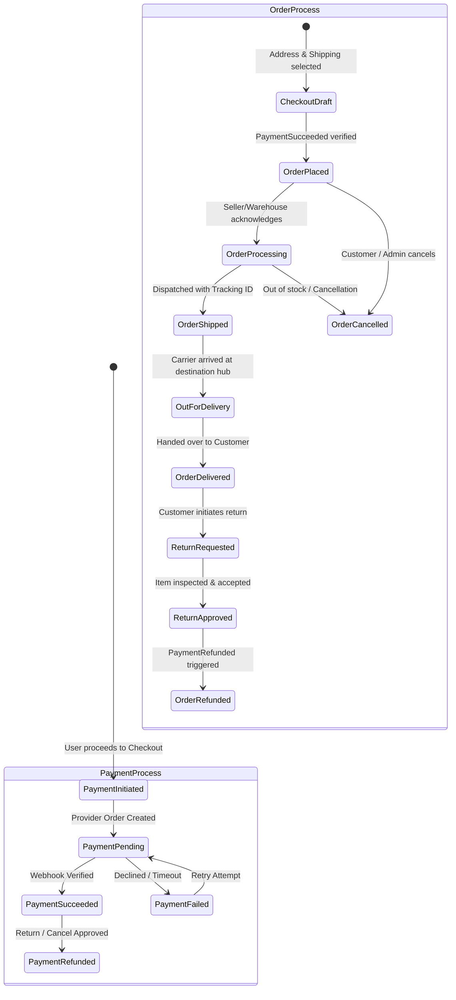
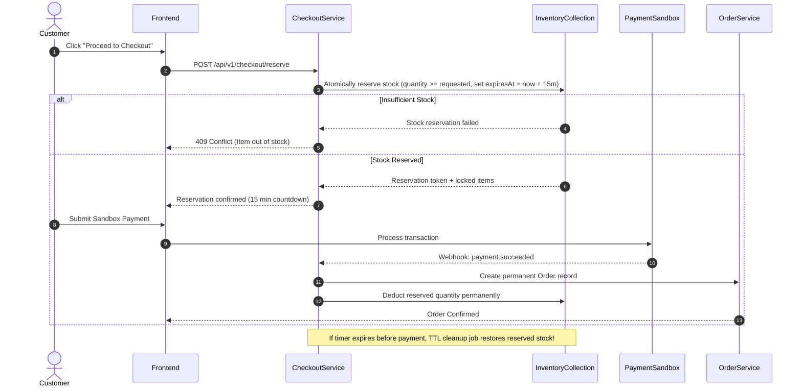

# Aventra Marketplace — System Architecture Specification

## 1. Architectural Style & Philosophy

Aventra is engineered as a **Modular Monolith** backend paired with a **Single Page Application (SPA)** frontend. 

Rather than adopting complex microservices prematurely, the modular monolith enforces strict domain boundaries inside a unified codebase. This ensures clear domain separation, fast local development on Windows, transactional safety via MongoDB multi-document transactions, and predictable end-to-end integration testing.



---

## 2. Directory Structure Layout

The repository follows a clean, decoupled monorepo structure:

```text
amazon/
├── frontend/                   # Frontend Application
│   ├── public/                 # Static assets, favicon, brand logos
│   ├── src/
│   │   ├── assets/             # SVGs, banner images, category icons
│   │   ├── components/         # Reusable UI component library
│   │   │   ├── common/         # Button, Input, Modal, Dropdown, Spinner, Alert
│   │   │   ├── layout/         # Header, MegaNav, Footer, Sidebar, Breadcrumb
│   │   │   ├── product/        # ProductCard, PriceDisplay, RatingStars, VariantSelector
│   │   │   ├── cart/           # CartItem, CartSummary, DeliveryEstimator
│   │   │   └── checkout/       # AddressSelector, PaymentForm, OrderSummary
│   │   ├── hooks/              # Custom React hooks (useCart, useAuth, useDebounce)
│   │   ├── layouts/            # StorefrontLayout, AdminLayout, SellerLayout, AuthLayout
│   │   ├── pages/              # Routed view components
│   │   │   ├── storefront/     # Home, ProductDetail, SearchResults, CategoryPage
│   │   │   ├── account/        # Profile, Orders, OrderDetail, Addresses, Wishlist
│   │   │   ├── checkout/       # CartPage, CheckoutPage, OrderConfirmation
│   │   │   ├── admin/          # AdminDashboard, Products, Orders, Users, Sellers
│   │   │   └── seller/         # SellerPortal, Listings, Inventory, SalesReport
│   │   ├── services/           # Typed API clients (authApi, productApi, orderApi)
│   │   ├── store/              # Zustand state slices (authStore, cartStore, uiStore)
│   │   ├── types/              # Frontend TypeScript interfaces & DTOs
│   │   ├── utils/              # Formatters (currency, dates), sanitizers, validators
│   │   ├── App.tsx             # Root routing and context providers
│   │   ├── index.css           # Tailwind base styles and design tokens
│   │   └── main.tsx            # Application entrypoint
│   ├── index.html
│   ├── package.json
│   ├── tailwind.config.ts
│   ├── tsconfig.json
│   └── vite.config.ts
│
├── backend/                    # Backend Application
│   ├── src/
│   │   ├── config/             # Environment parser, DB connector, CORS config
│   │   ├── constants/          # Roles, OrderStatus, PaymentStatus, ErrorCodes
│   │   ├── middleware/         # Auth, Authorization, Validation, Error, RateLimit
│   │   ├── modules/            # Domain-driven modular packages
│   │   │   ├── auth/           # AuthController, AuthService, AuthRoutes, AuthValidation
│   │   │   ├── users/          # Profile, Address management
│   │   │   ├── products/       # Products, Variants, Brands, Categories
│   │   │   ├── search/         # Full-text search, autocomplete, faceted filters
│   │   │   ├── cart/           # Persistent cart, guest cart merge
│   │   │   ├── wishlist/       # Saved items management
│   │   │   ├── checkout/       # Checkout preparation, stock reservation with TTL
│   │   │   ├── orders/         # Order state machine, invoice generator, cancellation
│   │   │   ├── payments/       # Sandbox payment driver, webhooks, idempotency
│   │   │   ├── reviews/        # Verified reviews, helpful votes, rating summaries
│   │   │   ├── returns/        # Return requests, inspection, refund dispatch
│   │   │   ├── support/        # Support ticket threads, messaging
│   │   │   ├── admin/          # Admin analytics, moderation, audit logging
│   │   │   ├── sellers/        # Seller registration, isolated portal, commissions
│   │   │   └── notifications/  # Email templates, dispatch service, price alerts
│   │   ├── utils/              # Logger, API response helper, crypto helpers
│   │   ├── app.ts              # Express application configuration
│   │   └── server.ts           # HTTP server listener and graceful shutdown
│   ├── package.json
│   ├── tsconfig.json
│   └── .env.example
│
├── shared/                     # Shared Types & Contracts between Frontend & Backend
│   └── types/                  # UserDTO, ProductDTO, OrderDTO, APIResponse
│
├── docs/                       # Architectural & Project Documentation
│   ├── PROJECT_REQUIREMENTS.md
│   ├── SYSTEM_ARCHITECTURE.md
│   ├── DATABASE_SCHEMA.md
│   ├── API_SPECIFICATION.md
│   ├── IMPLEMENTATION_ROADMAP.md
│   └── PROGRESS.md
│
└── README.md
```

---

## 3. Layered Module Structure (Backend)

Every backend module conforms strictly to the following 5-layer separation:

```text
modules/<domain>/
├── <domain>.model.ts        # Mongoose Schema, Document Interface, Model Indexes
├── <domain>.types.ts        # Domain-specific TypeScript Interfaces and DTOs
├── <domain>.validation.ts   # Zod Validation Schemas for params, query, body
├── <domain>.service.ts      # Pure business logic, DB queries, transactions
├── <domain>.controller.ts   # HTTP Request/Response handling, status code mapping
└── <domain>.routes.ts       # Express Router with middleware guards attached
```

### Server-Side Data Authority Rule
The browser is strictly treated as an untrusted presentation surface:
- **Product Prices & Discounts:** Always retrieved directly from MongoDB during cart calculation and checkout.
- **Inventory & Stock:** Checked and atomically reserved on the server; client counts are advisory only.
- **Roles & Permissions:** Extracted exclusively from verified JWT signatures and database records.
- **Payment Verification:** Verified via cryptographic webhook signatures and direct server-to-server gateway queries.

---

## 4. State Machines & Critical Lifecycles

### 4.1 Order Lifecycle vs. Payment Lifecycle
The system strictly decouples the **Payment Status** from the **Order Fulfillment Status**:



### 4.2 Safe Inventory Reservation Lifecycle
To prevent overselling under high concurrency without permanent stock depletion:



---

## 5. Security & Authentication Architecture

1. **Password Security:** Passwords hashed with `bcrypt` (12 salt rounds) or `argon2id`. Plaintext passwords are never logged or stored.
2. **Token Strategy:**
   - **Access Token:** Short-lived JWT (15 minutes lifespan) containing `userId`, `role`, and `tokenVersion`. Sent in the `Authorization: Bearer <token>` header or read from secure cookie.
   - **Refresh Token:** Long-lived JWT (7 days lifespan) stored in an `httpOnly`, `Secure`, `SameSite=Strict` cookie.
   - **Token Revocation:** User records carry a `tokenVersion` integer. Changing password or triggering "Logout from all devices" increments this version, instantly invalidating all active refresh tokens.
3. **Cross-Site Request Forgery (CSRF):** Mitigation via `SameSite=Strict` cookies and custom header validation.
4. **Rate Limiting:** Global rate limiters on all routes plus aggressive limits on authentication endpoints (`/api/v1/auth/login`, `/api/v1/auth/register`).
5. **Input Sanitization:** Server-side validation via `Zod` and MongoDB query sanitization to prevent NoSQL operator injection.

---

## 6. Uniform API Envelope & Centralized Error Handling

Every REST response conforms to a standardized JSON envelope:

### Success Response:
```json
{
  "success": true,
  "statusCode": 200,
  "message": "Resource fetched successfully",
  "data": { ... },
  "meta": {
    "page": 1,
    "limit": 20,
    "total": 142,
    "totalPages": 8
  }
}
```

### Failure Response:
```json
{
  "success": false,
  "statusCode": 400,
  "error": {
    "code": "INVALID_COUPON_CODE",
    "message": "The coupon 'SAVE50' has expired or reached its maximum usage limit.",
    "details": [
      { "field": "couponCode", "issue": "Expired on 2026-10-15" }
    ]
  }
}
```

---

## 7. Development & Production Deployment Target

- **Development OS:** Windows 10/11 using PowerShell / Bash with cross-platform npm scripts (`cross-env`).
- **Database:** MongoDB Community Server local instance or MongoDB Atlas free-tier cluster.
- **Frontend Serving:** Vite dev server on `http://localhost:5173` with reverse proxy to backend on `http://localhost:5000`.
- **Production Build:**
  - Client compiles to optimized static assets in `frontend/dist/`.
  - Server compiles TypeScript to clean JavaScript in `backend/dist/`.
  - Express serves the API under `/api/v1/*` and optionally serves the client static bundle for single-container hosting.
